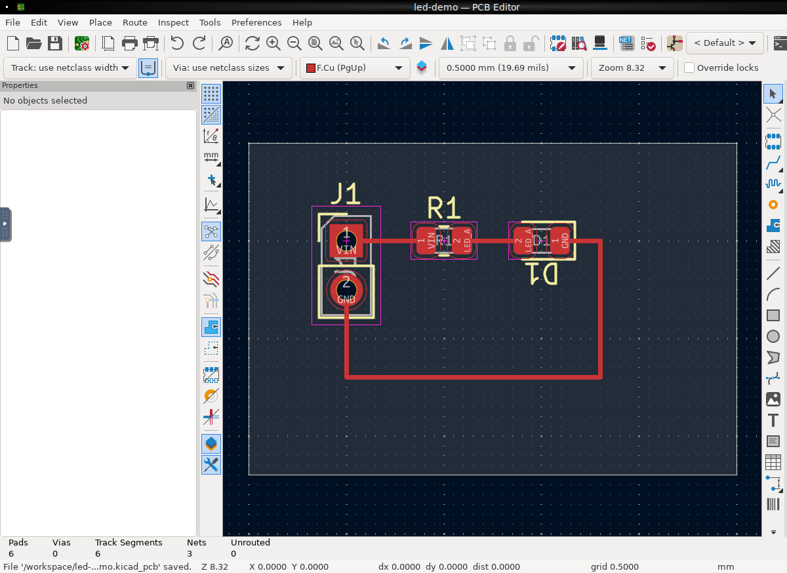

# agent-tool-kicad

KiCad 10 browser desktop and Konnect MCP in one Docker container.
Agents edit schematics and PCBs; people inspect the same workspace through noVNC.



## Ask your agent

Copy [AGENT_PROMPT.md](AGENT_PROMPT.md) and replace design placeholder.
Prompt covers local installation, Docker startup, MCP connection, design, checks, and exports.
No account, private network, or host CAD installation is required to run this tool.
GitHub and public package repositories need internet access during installation.

## Automatic local setup

Clone repository, enter directory, then run:

```sh
python3 scripts/setup.py
```

Keep at least 12 GiB free on host disk before building; native ARM64 builds need 20 GiB for Rust build data.
Python 3.10+ standard library is enough. On Windows, use `py -3` or `python` if needed.
Setup preserves other .env settings, checks loopback port availability, and runs smoke checks.
Setup also verifies FreeRouting native MCP integration.
On small machines, setup caps CPU limit to Docker engine CPU count and saves that limit.
Default host port: **48322**. Occupied defaults use another available port, saved in .env.
To require a specific free port, use `python3 scripts/setup.py --port 49000`.
Environment variables override .env; clear any conflicting `KICAD_PORT` override before later manual Compose commands.
Direct `docker compose up` uses configured port and reports conflicts; it does not select another port.
Container port stays 8080. Two repositories use different default host ports and independent named volumes.

## Agent connection

Service exposes Streamable HTTP MCP. Use setup's reported URL in your harness's documented MCP settings.
MCP syntax and reload behavior vary by harness. Native integration requires Streamable HTTP support.
When native MCP cannot reload during chat, agents with terminal access can use bundled client:

```sh
python3 scripts/mcp.py --url http://localhost:48322/mcp list
python3 scripts/mcp.py --url http://localhost:48322/mcp call get_installation_info
```

Returned images save under `.agent-output/`; CLI prints local file paths instead of base64.
Use `--images-dir` to choose another directory.
For tool arguments, pass a JSON object or `@arguments.json`. Client returns JSON and exits nonzero on tool errors.
Read live tool schemas before creating designs. Setup and connection checks do not prove design correctness.
Cloud-only agents need an approved route to your computer; localhost URLs work only on Docker host.

## Run

Requires Docker Engine with Compose v2, or Docker Desktop using Linux containers.
Allocate at least 6 GiB memory to Docker. Image builds natively on Linux amd64 and arm64, including Apple Silicon.
ARM64 compiles Konnect from vendored source; first build takes longer.
For deliberate emulation, use Docker standard override `DOCKER_DEFAULT_PLATFORM=linux/amd64`.

```bash
git clone https://github.com/RexSpex/agent-tool-kicad.git
cd agent-tool-kicad
docker compose up -d --build --wait
```

Desktop: http://localhost:48322/
MCP: http://localhost:48322/mcp (Streamable HTTP)

Example MCP client entry (syntax varies by client):

```json
{"mcpServers":{"kicad":{"url":"http://localhost:48322/mcp"}}}
```

Konnect exposes a starter toolset. Use `list_toolboxes` and `load_toolset` to
find more tools. Tools auto-load when called; clients that cache their initial
list must load toolsets explicitly or enable `eager_toolsets` in
`docker/konnect.toml` and rebuild. No client skills or credentials are installed.

## Workspace and desktop

Projects persist in named `workspace` volume at `/workspace`.
Desktop settings persist in named `home` volume at `/home/cad`.
PCB Editor opens `/workspace/led-demo/led-demo.kicad_pcb` on startup.
First run creates an empty board. The acceptance scripts populate this demo.

Konnect uses live IPC for PCB changes. Most PCB tools require the target board
open in PCB Editor. Schematic tools edit files on disk. Close Schematic Editor
before MCP schematic edits and reopen afterward to avoid stale saves.
Use one writer per project and one managed container per workspace volume.
Startup holds a workspace lock and clears stale cad-owned KiCad locks only for
the managed demo. Take copies before editing valuable designs.
Standard symbol and footprint libraries are included. Standard 3D model library
is omitted; add project-specific models when needed.

Copy projects and exports out:

```bash
docker compose cp kicad:/workspace ./workspace-copy
```

Stop while retaining data:

```bash
docker compose down
```

`docker compose down -v` deletes project and desktop volumes.

## Validate

```bash
python3 tests/smoke.py http://localhost:48322
python3 tests/freerouting.py http://localhost:48322
python3 tests/build_demo.py http://localhost:48322
python3 tests/route_demo.py http://localhost:48322
docker compose stop
docker compose run --rm --no-deps -T --entrypoint python3 kicad - < scripts/clean_demo.py
docker compose up -d --wait
python3 tests/verify_clean.py http://localhost:48322
docker compose exec -T kicad python3 - < tests/verify_saved.py
```

Demo creation requires untouched first-run board and no existing demo schematic.
It refuses existing files rather than replacing them. Use a separate Compose
project for a fresh validation workspace. Smoke checks are read-only.
Small board passes full ERC/DRC with zero errors, warnings, unrouted connections,
or schematic parity differences after native repair. See `docs/validation.md` for measured results and limitations.

## Access boundary

Default listener binds host loopback only. Desktop and MCP have no application
password. Use SSH forwarding or authenticated private ingress for remote access.
Never publish this port to an untrusted network.

Container runs as UID 1000, drops all capabilities, and uses no-new-privileges.
No Docker socket or host credentials are mounted. Konnect has
access to the container's filesystem and network; `/workspace` is a convention,
not a Konnect path sandbox. Container isolation is the filesystem boundary.
Konnect rejects foreign browser Origin headers on MCP requests.

## Configure

Copy `.env.example` to `.env` to adjust port, CPU, or memory.
Defaults: loopback port 48322, 4 CPUs, 6 GiB memory, 512 processes.
Configuration and desktop services live under `docker/`.
Default Compose needs no external Docker network or machine-specific paths.
For a remote deployment, keep its port, storage, ingress, and access settings
in a separate override outside this repository:

```bash
docker compose -f compose.yaml -f /path/to/deployment/compose.override.yaml up -d --build --wait
```

The override must preserve persistent volumes and restrict desktop/MCP access
to trusted clients. Use the standard localhost endpoints for local operation.

## Components and source

KiCad 10 from official stable PPA, Konnect v0.13.0, FreeRouting v2.3.0,
Temurin Java 25, Xvfb, Fluxbox, x11vnc, noVNC/websockify, nginx, and Supervisor.
Konnect amd64 release archive and FreeRouting JAR are checksum verified.
ARM64 builds same Konnect version from unmodified source in `vendor/Konnect`.
See `UPSTREAM.md`. Package uses AGPL-3.0.

FreeRouting lives at `/opt/freerouting/freerouting.jar`. Nginx and terminal clients
allow routing requests up to two hours. Set `MCP_HTTP_TIMEOUT_SECONDS` to adjust client timeout.
